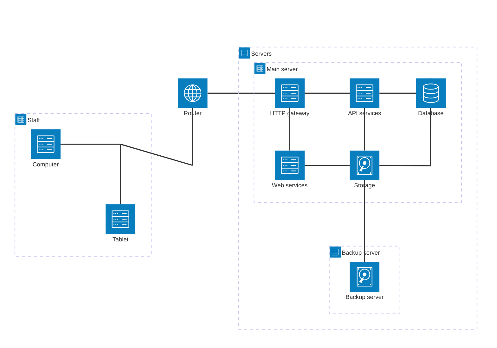

# Usage

This page explains how to get started with rehua.

## Deployment steps

1. Install docker on the server
2. Download the `docker` folder from [BozhanL/rehua-doc](https://github.com/BozhanL/rehua-doc). You can either run `git clone https://github.com/BozhanL/rehua-doc.git` or click <https://github.com/BozhanL/rehua-doc/archive/refs/heads/main.zip> to download entire repository, and delete unwanted files
3. Enter the `docker` folder by `cd docker`
4. Execute `nginx/html/create_web.sh` to download and compile the web
5. Replace `logo.jpg` and `favicon.jpg` with your own logo in `nginx/html/rehua` folder
6. (Optional) Edit the image version for `api` in `compose.yaml` to match web version. Default is `main`
7. Update `JWT_SECRET` in `compose.yaml` with your own secret key, generated using OpenSSL `openssl rand -hex 32` or other key generator
8. Edit username, password, connection string for mongo in `mongo/mongo_username.txt`, `mongo/mongo_password.txt`, `mongo/mongodb_url.txt`. Default is `admin`
9. Execute `certs/create_test_cert.sh` to create internal certificates
10. Edit `nginx/conf/conf.d/rehua.conf` to change `server_name` to your own domain.
11. Put SSL/TLS certificate and private key into the local `certs/nginx` folder, and update `ssl_certificate` and `ssl_certificate_key` in `nginx/conf/conf.d/rehua.conf`. (This folder is mounted into the nginx container at `/cert`.)
12. Run `docker compose up -d` to start all services.

## Add First Admin User

1. Access MongoDB Shell
   Run the following command in your terminal to access the MongoDB shell using `docker-compose`:

```bash
docker compose exec -it mongo sh -c '
mongosh \
  "mongodb://127.0.0.1:27017/?authSource=admin" \
  --username "$(cat /run/secrets/mongo_username)" \
  --password "$(cat /run/secrets/mongo_password)" \
  --tls \
  --tlsCAFile /cert/ca.pem \
  --tlsCertificateKeyFile /cert/fullchain_with_key.pem \
  --tlsAllowInvalidHostnames'
```

2. Insert Admin user document

```javascript
use rehua

db.users.insertOne({
   "userName": "admin1",
   "firstName": "Admin",
   "lastName": "Admin1",
   "password": "$2b$10$hUHQsZLMXpjHMO9qbUhnkuSmo4oKLFrFfog3eTe1.QlPLnQ4ser7a",
   "totpSecret": "JBSWY3DPEHPK3PXPJBSWY3DPEHPK3PXP",
   "email": "N/A",
   "status": "active",
   "homePhoneNumber": "N/A",
   "address": "N/A",
   "group": "admin",
})
```

3. use a totp website or app to get rolling code for the totp secret `JBSWY3DPEHPK3PXPJBSWY3DPEHPK3PXP`
4. Login using the username `admin1` and the password `password123`, then enter the totp rolling code
5. In the user dashboard reset the `password` and `MFA` for the `admin` user

## Reset Admin password and totp secret

1. Access MongoDB Shell
   Run the following command in your terminal to access the MongoDB shell using `docker-compose`:

```bash
docker compose exec -it mongo sh -c '
mongosh \
  "mongodb://127.0.0.1:27017/?authSource=admin" \
  --username "$(cat /run/secrets/mongo_username)" \
  --password "$(cat /run/secrets/mongo_password)" \
  --tls \
  --tlsCAFile /cert/ca.pem \
  --tlsCertificateKeyFile /cert/fullchain_with_key.pem \
  --tlsAllowInvalidHostnames'
```

2. Update a users document

```javascript
use rehua

db.users.updateOne(
  { userName: "REPLACE WITH YOUR USERNAME" },
  {
    $set: {
      password: "$2b$10$hUHQsZLMXpjHMO9qbUhnkuSmo4oKLFrFfog3eTe1.QlPLnQ4ser7a",
      totpSecret: "JBSWY3DPEHPK3PXPJBSWY3DPEHPK3PXP"
    }
  }
)
```

3. use a totp website or app to get rolling code for the totp secret `JBSWY3DPEHPK3PXPJBSWY3DPEHPK3PXP`
4. Login using your username and the password `password123`, then enter the totp rolling code
5. In the user dashboard reset the `password` and `MFA` for the `admin` user

## Structure diagram


